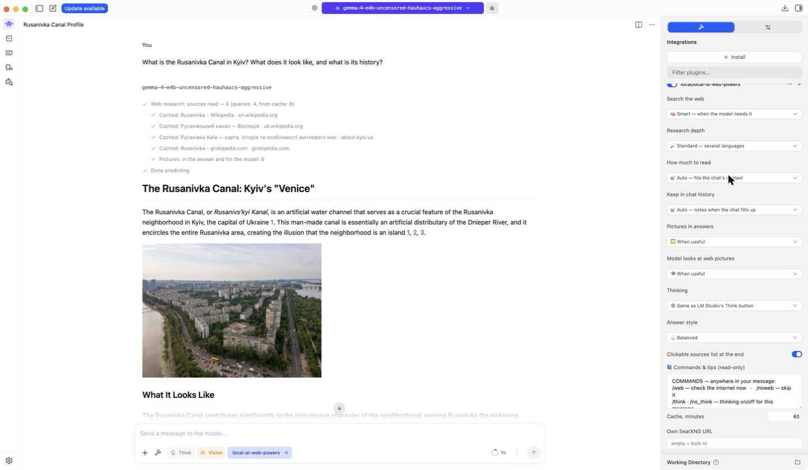
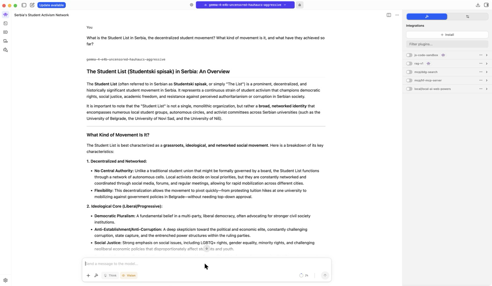
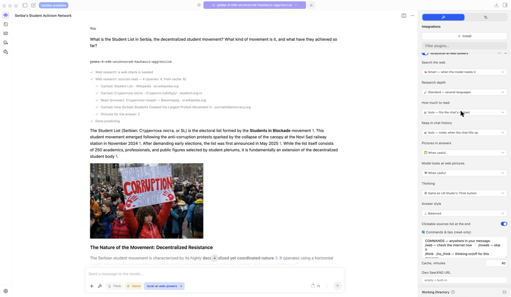
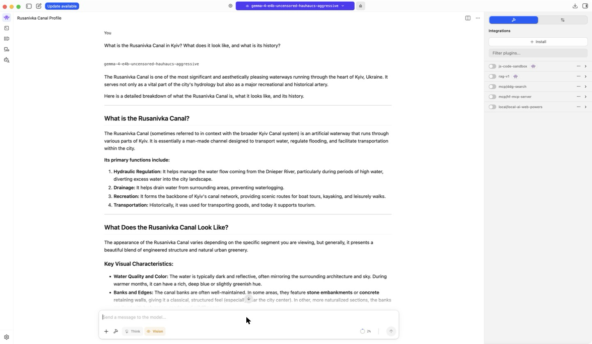
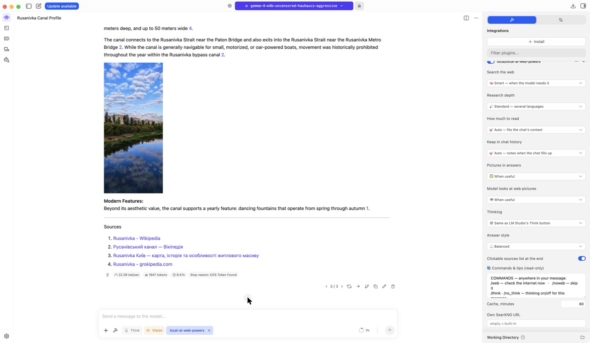
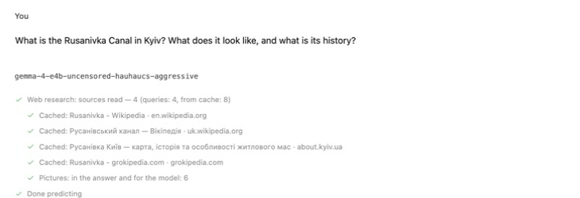
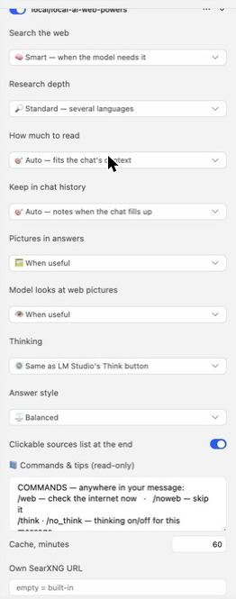
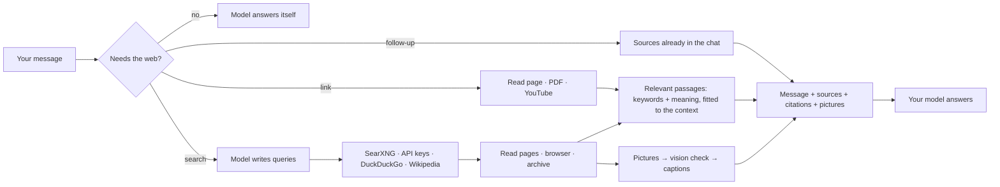

# Local AI Web Powers

[](https://github.com/Kreal-exe/local-ai-web-powers/actions/workflows/ci.yml) [](https://lmstudio.ai/kreal/local-ai-web-powers) [](LICENSE)

**Real internet access for any local model in LM Studio** — search, reading websites, PDFs and YouTube, multi-step research, illustrated answers with pictures the model has checked, and a clickable source for every claim.
Fully local · no API keys · no Docker · no Node.js · works even with models that **cannot call tools** · careful with your context window.



---

## Why

Local models know nothing after their training date and invent the rest. The usual fixes break often:

- **Tool-based plugins and MCP servers** need the model to call a tool with perfect syntax. Small, quantized, abliterated or "heretic" models often fail at that (`Failed to parse tool call…`), so for them the internet simply doesn't work.
- **Separate apps** (Open WebUI, Perplexica/Vane, Local Deep Research) live outside LM Studio and usually need Docker or paid search APIs.

**Local AI Web Powers is a prompt preprocessor.** Before your model writes a token, the plugin decides whether the web is needed, searches, reads the pages, keeps only the passages that matter, picks pictures and hands it all over with ready-made citations. The model only reads and answers — and it still does the thinking: the plugin supplies sources, not answers.

## See the difference

Same model (Gemma 4 E4B), same chat: first answered with the plugin switched off, then regenerated with it on.

**"What is the Student List in Serbia, and what has it achieved so far?"**

| Plugin off | Plugin on |
|---|---|
|  |  |
| An invented name ("Studentski spisak"), a vague "network of activists", nothing about the 2026 election, no sources | The electoral list of the *Students in Blockade* movement, its origin and results, 23 clickable citations, protest photos placed in the text |

**"What is the Rusanivka Canal in Kyiv? What does it look like, and what is its history?"**

| Plugin off | Plugin on |
|---|---|
|  |  |
| Generic "hydraulic regulation, drainage, transportation" | The canal that makes Rusanivka an island, its size, bridges and fountains, 25 citations, photos checked by the model |

The end of the answer: pictures spread through the text, then the clickable sources.



The plugin shows each step in the chat — whether the web was needed, the pages it read, what came from cache, how many pictures it picked:



## Features

### 🧠 Decides when to go online
| Mode | What happens |
|---|---|
| 🧠 **Smart** *(default)* | The loaded model decides in 1–3 s whether the message needs the web: recent events, people, prices, numbers, releases, anything it isn't sure about. The plugin reads the model's own confidence (token probabilities): when it is unsure, the web is checked. Poems, math, code and well-known facts are answered without it. |
| 🌐 **Always** | Every message is checked online. |
| 🔑 **On keywords** | Only for words like *find, news, latest, today, 2026*. |
| ✋ **Only with /web or a link** | Nothing happens unless you ask. |

Links in the message and follow-up questions work in every mode; small talk never triggers a search.

### 🔎 Research
- **Built-in [SearXNG](https://github.com/searxng/searxng)** metasearch. LM Studio downloads the binary for your OS together with the plugin; the plugin starts it when needed. The engines are picked from what actually answers keyless requests in 2026 (DuckDuckGo, Brave, Yahoo, Yandex, Mwmbl, Wikipedia); Google, Qwant and Bing's unrelated web results are switched off, so results keep coming when one engine rate-limits.
- **Optional API keys** (Tavily, Brave, Ollama web search) are used first when you add them. Fallbacks: your own SearXNG → built-in → DuckDuckGo (its CAPTCHA is recognised and reported, not mistaken for "no results") → Wikipedia's own search when results are thin. Unrelated results (shop locators, login pages) are dropped.
- **Queries in several languages:** the model adds an English query and, for topics tied to a country, one in its language (Serbian for a Serbian election).
- **Deep mode** searches again for what the first round missed. **Time filters:** "this week", `/day`, `/week`, `/month`, `/year`.

### 📖 Reading
- **Main content as compact Markdown** ([Defuddle](https://github.com/kepano/defuddle)): headings, lists and tables stay; menus, links, footnotes and reference lists go. Publication dates are shown next to each source.
- Static fetch first; a **headless browser** (your Chrome or Edge, or a small Chromium downloaded once) for JavaScript sites and bot walls; the **Internet Archive's latest copy** when a page is down or blocked.
- **PDF** (also without `.pdf` in the URL; two-column papers are read column by column) and **YouTube transcripts** (several app clients, so it keeps working when YouTube rate-limits the website).
- **Pasted links** are read in full, plus the most relevant pages of the same site.
- **Safe by design:** every connection — pages, redirects, and everything the browser loads (the browser itself resolves no names; the plugin fetches for it) — is checked against the address it really goes to, so nothing found on the web can reach your computer, your local network or cloud metadata addresses, also with DNS tricks. Local links you paste yourself (e.g. `http://nas.local`, `192.168.1.10`) are allowed for that message.

### ✂️ Careful with the context window
LM Studio keeps everything a plugin adds in the chat history, so web research can fill a small context fast. The plugin works against that:
- **Fits the context:** it checks the model's context and what the chat already uses, and keeps each researched message under ~4k tokens (typically ~3k for 4–6 pages).
- **Only relevant sentences:** BM25 with real stemming (Snowball Russian, Porter English) picks passages across all pages, then drops sentences without words of the question, citation markers and boilerplate. With an embedding model installed in LM Studio, passages are also ranked by meaning — it finds the same fact in other words or another language (a multilingual model such as bge-m3 or Qwen3-Embedding for non-English chats; the built-in nomic-embed covers English).
- **Follow-ups cost almost nothing:** "and what did they achieve after the election?" is answered from the sources already in the chat — the plugin adds only a one-line list of them, no new text. A new topic in the same chat starts a new search.
- **Notes when the chat fills up:** past half of the context, sources are first condensed into short cited notes in a separate call (not kept in the chat), so later answers can read *more* pages for *less* history.

### 🖼️ Pictures
Two separate jobs:
- **Pictures in answers** — illustrated, article-style answers for real-world topics (places, nature, events, architecture, animals, products…), up to 6 pictures, spread through the text. Works with any model; costs about 20 tokens per picture, because the model only gets a file name.
- **The model looks at pictures** — when the answer depends on what is visible (appearance, colours, maps, charts, identification), a vision model studies them.

How pictures are chosen: candidates from the pages and from image search → tiny, stretched and duplicate images are dropped → a **vision model checks the rest in a separate call** (keeps real, on-topic photos, drops logos, banners, text graphics and watermarked stock) and writes what each one shows. Those descriptions guide where each picture goes, and replace attaching the images to the chat. Pictures you attach yourself are always seen by the model, and the web search looks for what is in them.

### 💭 Thinking
Follow LM Studio's **Think** button, or force it off/on per chat; `/think` and `/no_think` per message. Works also for MLX models whose template never receives LM Studio's switch (see [Extras](#extras)).

### 🔗 Answers
Clickable citations `[1](url)`, a numbered **Sources** list, a note when sources disagree, the answer in the language of the question, chats named after your question.

### 🛠️ Tools for strong models (optional)
Models with native tool use (Qwen 3.x, GLM, gpt-oss, Gemma 4 and others) can also get `read_more` (the rest of a source page, 5,000 characters at a time) and `search_web`. Off by default: small and abliterated models often fail at tool calls, and the research before every answer already works for them.

## Commands

Anywhere in your message:

| Command | |
|---|---|
| `/web` · `/noweb` | Check the web for this message · skip it |
| `/think` · `/no_think` | Thinking on/off for this message |
| `/fresh` · `/clearcache` | Ignore the cache once · empty it |
| `/day` `/week` `/month` `/year` | Only recent results |

## Settings

Right panel → **Integrations** → expand `local-ai-web-powers`. The same panel shows **📘 Commands & tips**.



| Setting | Options · *default* |
|---|---|
| Search the web | *🧠 Smart* · 🌐 Always · 🔑 On keywords · ✋ Only with /web or a link |
| Research depth | ⚡ Quick · *🔎 Standard* · 🧭 Deep |
| How much to read | *🎯 Auto — fits the chat's context* · 📄 Light · 📚 Normal · 🗄️ Heavy |
| Keep in chat history | *🎯 Auto — notes when the chat fills up* · 🗒️ Short notes · 📄 Compact sources |
| Pictures in answers | *🖼️ When useful* · 📰 Always illustrate · 🚫 Never |
| Model looks at web pictures | *👁️ When useful* · 🔬 Always · 🚫 Never |
| Thinking | *⚙️ Same as LM Studio's Think button* · ⚡ Off · 💭 On |
| Answer style | *⚖️ Balanced* · ✂️ Short · 📝 Detailed |
| Clickable sources list | *on* |
| Cache, minutes *(global)* | *60* — PDFs/videos 7 days, news 10 min |
| Own SearXNG URL *(global)* | *empty = built-in* |
| Passage ranking *(global)* | *🎯 Auto — keywords + embedding model if installed* · 🔤 Keywords only |
| Tools for tool-calling models *(global)* | *off* |
| Tavily / Brave / Ollama key *(global)* | *empty* — used before the free engines when set |

## Install

**From LM Studio Hub (one click):** open [lmstudio.ai/kreal/local-ai-web-powers](https://lmstudio.ai/kreal/local-ai-web-powers) and press **Run in LM Studio**. Then switch on **`local-ai-web-powers`** in **Integrations**.

**From source:**

```bash
git clone https://github.com/Kreal-exe/local-ai-web-powers
cd local-ai-web-powers/plugin
lms dev --install -y
```

`lms` ships with LM Studio (`~/.lmstudio/bin/lms`, Windows: `%USERPROFILE%\.lmstudio\bin\lms.exe`). LM Studio installs the dependencies itself — no Node.js or npm needed.

Tips: with LM Studio's local server on (**Developer → Start server**) the plugin's helper calls are faster (it finds the port itself). For long chats load the model with a bigger context and set **Context Overflow → Rolling Window**.

## How it works



## Measured (MacBook Pro M1 Pro 16 GB, Gemma 4 E4B, 64k context)

| | |
|---|---|
| Smart-mode decision | 1–3 s |
| Search question, 4–6 pages | ~4–8 s before the model starts (more on the first run) |
| Added to the chat per researched question | ~2–3k tokens (follow-ups: a few dozen) |
| Picture check by the vision model | ~10 s for 6 pictures, not kept in the chat |
| PDF · YouTube transcript | ~1–2 s |
| Same question again | instant (cache) |

## Extras

**Turn off endless thinking (Qwen-style MLX models).** Many MLX models think before every answer because LM Studio's MLX engine doesn't pass the thinking switch to their template. [`extras/disable-thinking`](extras/disable-thinking/disable-thinking.mjs) makes "no thinking" the default and lets `/think`, the plugin or LM Studio's Think button turn it on per message (backup kept, `--restore` undoes it):

```bash
~/.lmstudio/.internal/utils/node extras/disable-thinking/disable-thinking.mjs ~/.lmstudio/models/<publisher>/<model>
```

**Big MLX models on 16 GB Macs.** LM Studio's MLX engine processes prompts in 2048-token chunks; with large models a chunk can exceed GPU memory (`Insufficient Memory`). [`extras/macos-mlx-memory`](extras/macos-mlx-memory): `patch-mlx-prefill.command` sets 512-token chunks (a 27B 2-bit model went from ~1,600 to 15,000+ tokens), `install-gpu-limit.command [MB]` raises the GPU memory limit at every boot (admin password; `uninstall-gpu-limit.command` reverts).

## Troubleshooting

| | |
|---|---|
| "nothing found" | The status line says why (e.g. *DuckDuckGo shows a CAPTCHA*, *too many requests*): free engines rate-limit after many searches — wait a few minutes or add a free Tavily key. LM Studio's log shows `[web-powers]` lines with details. |
| Intel Mac | The built-in SearXNG has no Intel-Mac binary yet: search uses DuckDuckGo directly, or your API key / own SearXNG. |
| The plugin chip under the input turned the plugin off | The **×** on the chip disables it. Settings are in the right panel → Integrations. |
| The model never searches | *Search the web → Always*, or add `/web`. |
| "this chat's context is almost full" | Start a new chat or load the model with a bigger context. |
| `Insufficient Memory` on a Mac | See *Extras*. |
| JavaScript sites don't open | The plugin uses Chrome or Edge, otherwise downloads a small Chromium once (needs ~100 MB and internet). Another Chromium-based browser: set the environment variable `WEB_POWERS_CHROME` to its executable. |

## Development

```bash
cd plugin
npm ci
npx -p typescript tsc --noEmit -p .   # strict type-check
npm test                              # unit tests
lms dev                               # live-reload into LM Studio
```

Every push runs [CI](.github/workflows/ci.yml) on Linux, Windows and macOS: type-check, the same esbuild bundle LM Studio builds, unit tests (stemming, the network guard, extraction, PDF column order, smart-mode probabilities, follow-up detection, passage selection), a load test of the bundle, and a syntax check of the extras.

## Privacy

Everything runs on your computer. Searches go from your machine to the engines SearXNG queries (or to Tavily/Brave/Ollama if you add a key); pages and pictures are fetched directly; Wikipedia's search and the Internet Archive are asked only when needed. Keys are stored as protected fields in LM Studio and sent only to their own service. Cache: `~/Library/Caches/local-ai-web-powers` (macOS), `%LOCALAPPDATA%\local-ai-web-powers` (Windows), `~/.cache/local-ai-web-powers` (Linux). No telemetry.

## License

MIT. Dependencies: SearXNG binaries AGPL-3.0 (installed as a separate package, not bundled), Playwright Apache-2.0, Defuddle MIT, linkedom ISC, undici MIT, pdf.js Apache-2.0, zod MIT. The Porter stemmer is adapted from [wooorm/stemmer](https://github.com/wooorm/stemmer) (MIT).

---

## По-русски

**Local AI Web Powers** даёт любой локальной модели в LM Studio настоящий интернет: встроенный поиск SearXNG, чтение сайтов, PDF и YouTube, многошаговый ресёрч, иллюстрированные ответы с картинками, которые проверила сама модель, и кликабельные сноски.

Это **препроцессор**, а не инструмент: плагин сам решает, нужен ли интернет (по уверенности самой модели), ищет и читает до ответа модели, поэтому работает и с моделями, которые не умеют вызывать инструменты. Он бережёт контекст: подстраивается под окно модели, берёт только нужные предложения (настоящий стемминг для русского и английского, ранжирование по смыслу при установленной embedding-модели), уточняющие вопросы почти не тратят токенов, а при заполнении чата сжимает источники в заметки. Защищён от обращений к локальной сети, читает PDF в две колонки, YouTube и копии из архива. Ключи API, Docker и Node.js не нужны (ключи Tavily/Brave/Ollama — по желанию). Установка в один клик: [lmstudio.ai/kreal/local-ai-web-powers](https://lmstudio.ai/kreal/local-ai-web-powers) → Run in LM Studio. Настройки — правая панель → Integrations.
